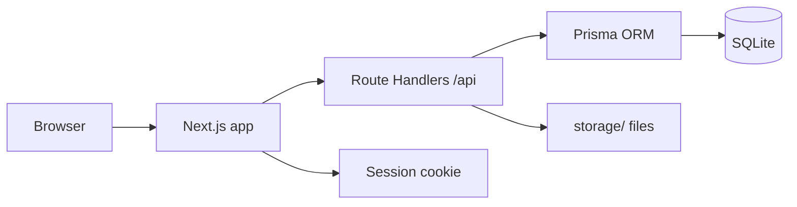

# Design: Music Stream

## Overview

Music Stream is a Spotify-like music streaming web app. Users register and sign in, browse a catalogue of songs, albums, artists and genres, search it, build playlists and favourites, and play music in a persistent player. Admins and Approved artists upload and manage the catalogue, and Admins manage it from a dashboard.

The app is a single Next.js application (App Router) that serves the responsive web/mobile UI and the API from one server. Data lives in SQLite, accessed through Prisma. Audio files and cover images are stored on the server's file storage, with their paths recorded in the database. Authentication uses signed HTTP-only session cookies.

## Architecture

- **Frontend:** Next.js App Router with React Server Components for data pages and client components for the player and interactive forms. Responsive layout for phone and desktop.
- **Backend:** Next.js Route Handlers under `/api` provide the JSON API. Server actions are not used for mutations; the API is the single source of truth so the admin dashboard and the user UI share it.
- **Database:** SQLite, one file, accessed through Prisma ORM. Migrations are applied by the seed/start path and by tests against their own throwaway database.
- **File storage:** audio files and cover images are written to a `storage/` directory on the server (git-ignored), served through a streaming route that enforces access rules.
- **Authentication:** password hashing with bcrypt, sessions as signed HTTP-only cookies.

## Components and Interfaces

### Data models (Prisma schema)

- **User** — id, email (unique), name, passwordHash, role (`USER` | `ADMIN` | `ARTIST`), approved (bool, for artists), createdAt.
- **Artist** — id, name, details, imagePath, ownerId (nullable; an Approved artist owns their own artist record).
- **Genre** — id, name (unique).
- **Album** — id, title, coverPath, artistId, ownerId.
- **Song** — id, title, audioPath, coverPath, artistId, albumId, genreId, ownerId, createdAt.
- **Playlist** — id, name, ownerId, createdAt.
- **PlaylistSong** — playlistId, songId (join, ordered).
- **Favorite** — userId, songId (join).

### API routes

- `POST /api/auth/register`, `POST /api/auth/login`, `POST /api/auth/logout`, `GET /api/auth/me`.
- `GET /api/songs`, `GET /api/songs/:id`, `POST /api/songs`, `PATCH /api/songs/:id`, `DELETE /api/songs/:id` (write routes restricted to Admin/Approved artist).
- `GET/POST/PATCH/DELETE /api/albums`, `/api/artists`, `/api/genres` (writes restricted to Admin; artist creation restricted to Admin).
- `GET /api/search?q=`.
- `GET /api/home` (personalised recommendations first, then songs/albums/artists/genres/playlists sections).
- `GET/POST /api/playlists`, `GET/PATCH/DELETE /api/playlists/:id`, `POST/DELETE /api/playlists/:id/songs`.
- `GET /api/favorites`, `POST /api/favorites`, `DELETE /api/favorites/:songId`.
- `GET /api/stream/:songId` — streams the audio file with range support for seeking.
- `GET /api/admin/...` — catalogue listing and artist approval (`POST /api/admin/artists/:id/approve`).

### Pages

- `/` — sign-in page (visitors) or homepage (signed-in Users and Approved artists); Admins are redirected to `/admin`.
- `/register` — registration.
- `/home` — homepage: personalised recommendations first, then songs, albums, artists, genres, playlists sections, a search field, and a link to favourites.
- `/search` — search results.
- `/songs/:id`, `/albums/:id`, `/artists/:id`, `/genres/:id` — detail pages.
- `/playlists`, `/playlists/:id` — playlist list and detail.
- `/favorites` — the User's favourites.
- `/upload` — upload form (Admin/Approved artist).
- `/admin` — admin dashboard (catalogue tables and add/edit/delete/approve controls).

### Player

A single client-side player component mounted once in the app shell, so it keeps playing across page navigation (background playback). It holds the current list, index, play/pause state, shuffle and repeat flags, volume, and progress, and streams audio through the `/api/stream/:songId` route.

## Data Models

See the Prisma schema above. Relationships: an Artist has many Albums and Songs; an Album has many Songs; a Genre has many Songs; a User owns Playlists and Favorites; a Playlist has many Songs through PlaylistSong.

## Error Handling

- API routes return JSON errors with an HTTP status: `400` for invalid input, `401` for unauthenticated, `403` for forbidden (e.g. a User uploading), `404` for missing records, `409` for duplicate email.
- Forms show the error message inline and keep the user's input.
- The stream route returns `404` when the file is missing and `403` when access is not allowed.

## Testing Strategy

- **Unit/integration tests** with Vitest cover the API routes and business rules (auth, permissions, playlists, favourites, search, recommendations) against a throwaway SQLite file in a temporary folder, created and removed by the test setup.
- **Component tests** cover the player controls (play/pause/next/previous/shuffle/repeat/volume/seek).
- **End-to-end journeys** are saved under `e2e/` with Playwright and run through `run_journeys` against the running app; the unit runner excludes `e2e/`.

## Build and run
Install: npm install
Test: npm test
Run locally: yes
Dev: npm run dev
Port variable: PORT
Health path: /api/health
Deploy: none

## Test logins

The seed script creates these accounts in a fresh local copy (never in production):

- Admin — `admin@musicstream.local` / `admin123`
- Approved artist — `artist@musicstream.local` / `artist123`
- User — `user@musicstream.local` / `user123`

## Look and feel

A clean, modern, dark streaming style, like the apps people know.

- **Colours:** background `#121212`, surface `#181818`, raised surface `#282828`, text `#ffffff`, muted text `#b3b3b3`, primary `#1db954` (green), error `#e91429`, success `#1db954`.
- **Font:** system UI stack (`-apple-system, "Segoe UI", Roboto, Helvetica, Arial, sans-serif`).
- **Spacing:** 4px base grid; 8/16/24/32px steps. Corner radius 8px for cards and fields, 999px for pills and the player's progress track.
- **Buttons:** primary buttons are green with dark text; secondary buttons are raised-surface with white text. Hover lightens the surface; focus shows a 2px green outline; pressed darkens; disabled is dimmed and not clickable.
- **Fields:** dark raised surface, white text, muted placeholder, green focus outline.
- **Lists:** cards on the surface colour with a cover image, title and subtitle; hover raises the card and shows a play button.

### Layout

- **Phone:** a single column; a bottom player bar pinned above a bottom navigation (Home, Search, Favourites, Playlists). The player expands to a full-screen sheet with large cover art and controls.
- **Desktop:** a left sidebar (Home, Search, Favourites, Playlists) and a main content area; the player is a fixed bar at the bottom with cover art, track info, transport controls (previous, play/pause, next, shuffle, repeat), a progress bar and a volume slider.

## Assumptions

- The stack is Next.js (App Router) with TypeScript, Prisma and SQLite, chosen by Greenfield as the brief's "decided by Greenfield" stack.
- Personalised recommendations are a simple rule: songs from genres and artists the User has favourited or played, falling back to recently added songs when the User has no history.
- Audio and cover files are stored under a git-ignored `storage/` directory on the server.
- An Approved artist can upload and manage only their own songs and albums; an Admin manages the whole catalogue.
